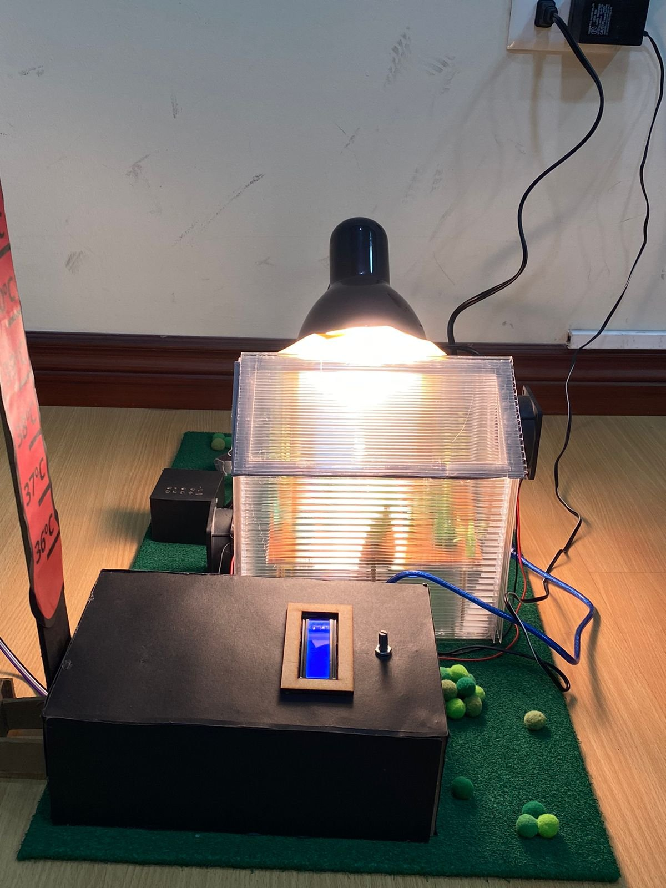
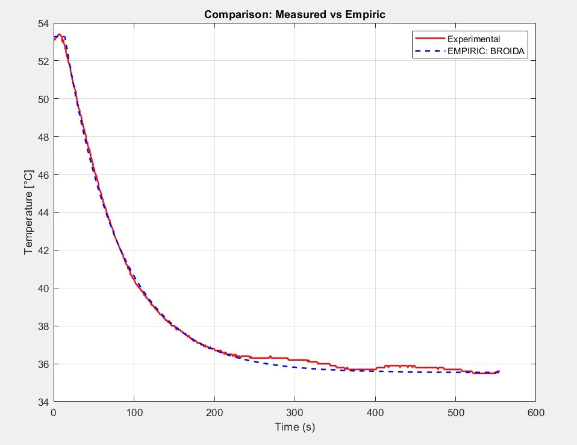
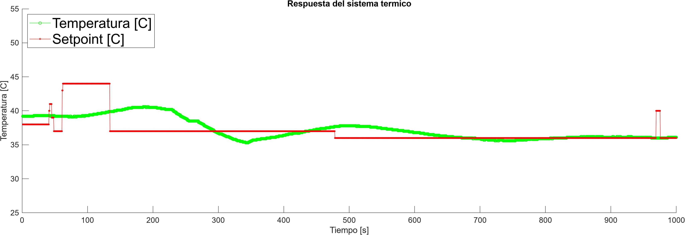
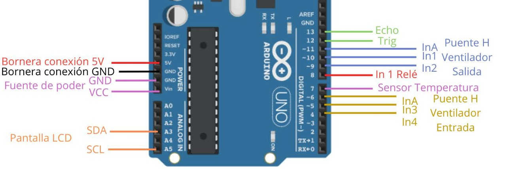

# Invernadero inteligente con control PID de temperatura

Prototipo de invernadero que mantiene la **temperatura óptima de las plantas** con un **controlador PID** implementado en **Arduino**. El PID regula por PWM la velocidad de dos ventiladores, y el **setpoint se ajusta automáticamente según la altura de la planta**, medida con un sensor ultrasónico.

> Proyecto de Sistemas y Control — Universidad San Francisco de Quito (USFQ), 2024.

  

## Cómo funciona

1. **Medición:** un sensor **DHT22** mide la temperatura dentro del invernadero cada 0,5 s.
2. **Setpoint según la planta:** un sensor ultrasónico **HC-SR04** mide la distancia hasta la planta y fija la temperatura objetivo con `setpoint = 46.62 − 0.27·d` (d en cm, si d < 39 cm). Por defecto el setpoint es 38 °C.
3. **Control PID:** con el error `e = setpoint − T`, el controlador calcula la acción

   `u = Kp · (e + Ki·∫e dt + Kd·de/dt)`, con `Kp = −50`, `Ki = 0.0145`, `Kd = 4.51`.

   La ganancia proporcional es negativa porque la acción es inversa: si la temperatura sube por encima del setpoint, los ventiladores giran más rápido para enfriar. La salida se limita entre 10 y 255 (PWM).
4. **Actuadores:** la señal PWM controla, mediante un **puente H**, el ventilador de entrada y el de salida de aire. La lámpara se conecta mediante un relé.
5. **Interfaz:** una pantalla **LCD 16×2 I2C** muestra la temperatura y la velocidad del aire (m/s). Por el puerto serie se envían tiempo, temperatura, setpoint y velocidad para graficar en **MATLAB** en tiempo real.

## Resultados

**Identificación del sistema.** La respuesta térmica en lazo abierto se ajustó a un modelo de primer orden con retardo por el **método de Broida**. El modelo empírico sigue de cerca la curva experimental.

  

**Respuesta en lazo cerrado.** Con cambios de setpoint, la temperatura converge al valor deseado y se mantiene estable en estado estacionario, con un error de aproximadamente **±0,5 °C**.

  

## Conexiones

  

| Componente | Pines del Arduino UNO |
|---|---|
| Sensor de temperatura DHT22 | D7 |
| Sensor ultrasónico HC-SR04 | TRIG D12 · ECHO D13 |
| Ventilador de salida (puente H) | EN D11 · IN1 D9 · IN2 D10 |
| Ventilador de entrada (puente H) | EN D6 · IN3 D4 · IN4 D5 |
| Relé de la lámpara | D8 |
| Pantalla LCD 16×2 I2C (0x27) | SDA A4 · SCL A5 |

## Estructura

| Archivo | Contenido |
|---|---|
| `controlArduino/controlArduino.ino` | Lectura de sensores, ajuste del setpoint, control PID y salida PWM |
| `matlab/grafica_tiempo_real.m` | Lectura del puerto serie y gráfica en tiempo real de temperatura y setpoint |
| `docs/images/` | Fotos, resultados y esquema de conexiones |

## Uso

1. Instala en el Arduino IDE las librerías **DHT sensor library** (Adafruit) y **LiquidCrystal I2C**.
2. Sube `controlArduino/controlArduino.ino` a un **Arduino UNO**.
3. Para graficar, abre `matlab/grafica_tiempo_real.m`, cambia `"COM5"` por el puerto de tu Arduino y ejecútalo.

## Tecnologías

Arduino UNO · C++ · Control PID · Identificación de sistemas (Broida) · DHT22 · HC-SR04 · Puente H · PWM · MATLAB

## Autor

**Matías Loayza Correa** — Ingeniero Mecánico, USFQ  
[Portafolio](https://mleo22d.github.io) · [LinkedIn](https://www.linkedin.com/in/matias-loayza)
